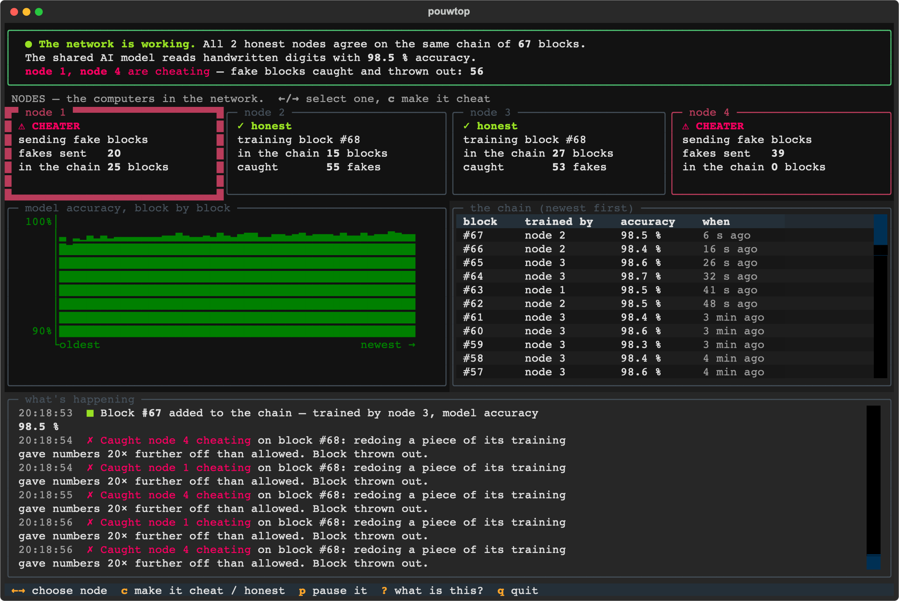

# pouwchain

**A blockchain whose consensus work is training a neural network — and a test bench for verifying that work.**

Instead of brute-forcing hashes, miners run steps of SGD on a shared model; every accepted block makes the
model a little better. The hard part is verification: a hash is checked in one operation, but checking that
someone really trained is nearly as expensive as training. This project implements the protocol end to end
(C++ nodes over TCP, PyTorch workers) and compares verification mechanisms against a common set of attacks
by detection rate, false rejections and cost.

Bachelor's thesis, Computer Science (122), Department of Artificial Intelligence Systems,
Lviv Polytechnic National University, 2027. The thesis materials in `docs/` are in Ukrainian.



## Highlights

- **Recompute-a-transition (B) is the best trade-off.** With a threshold calibrated across hardware
  (α = 0.05, CPU ↔ Apple GPU) it rejected no honest block and caught every attack that skips work, for 20 % of
  the cost of a block.
- **The strongest attack is a single poisoned transition** among honest ones ("one jump"): it costs the model
  ~0.48 accuracy and passes B with probability (1 − q/m)^V — measured and theory agree within ±2 %.
- **Threshold exploitation** (shifting every checkpoint just under the tolerance) barely hurts the model at a
  calibrated α but steals block rewards; a residual-direction test (R) blocks it at no extra cost.
- **Persistent workers** cut block verification from 6.98 s to 0.57 s and keep the network converging under
  a lazy node that floods it with blocks.

Full results with confidence intervals: [`docs/results.md`](docs/results.md) (Ukrainian; tables and figures
are self-explanatory).

## How a round works

1. The chain fixes the task (model, dataset, hyperparameters) and the current weights (by hash).
2. A miner trains K steps from the chain tip. The data order comes from `hash(prev block ‖ miner id ‖ round)`,
   so it cannot be chosen or copied. Every k steps it stores a checkpoint.
3. The block carries the checkpoint hashes, their root and the claimed accuracy; weights live in a
   content-addressed store.
4. Validators recompute q randomly chosen transitions (privately chosen, so the miner cannot predict them)
   and compare against the claimed checkpoints with a relative threshold.
5. The first valid block at a height wins; ties go to the smaller hash.

## Quick start

```sh
uv venv --python 3.12 .venv && uv pip install -r requirements.txt
cmake -S . -B build && cmake --build build -j

scripts/demo.sh                   # 3 honest nodes + 1 lazy attacker on MNIST, up to height 5
HEIGHT=0 scripts/demo.sh          # keep the network running (APIs on ports 9201–9204) ...
.venv/bin/python -m tui           # ... and watch it in another terminal; press l to turn a node into an attacker
```

## Testnet in Docker

Four nodes in containers (`compose.yaml`): node1–3 honest, node4 starts as a lazy attacker. Each node has its
own chain and weight store in a named volume; MNIST is downloaded once into a shared volume. Inside the
network the nodes bind with `--listen 0.0.0.0 --api-listen 0.0.0.0`; on the host the APIs are published only on
`127.0.0.1:9201–9204`.

```sh
docker compose up -d --build      # build the image, fetch MNIST, start node1–node4
.venv/bin/python -m tui           # pouwtop on the host; select a node and press l to toggle lazy mode
docker compose logs -f node1      # MINED / ACCEPT / REJECT lines
docker compose restart            # chains survive restarts
docker compose down -v            # stop and wipe chains, stores and the dataset
```

## Components

### Node (C++20) — `node/`

Block header with a canonical 236-byte encoding, chain with longest-chain fork choice, TCP P2P
(4-byte big-endian length + JSON), and a bridge to the Python worker. Dependencies (nlohmann/json, PicoSHA2,
cpp-httplib) are fetched by CMake.

- **Mining:** trains a block from the tip, aborting as soon as a new tip arrives.
- **Validation:** structural rules (parent link, `w_start` = parent's `w_end`, K/k, checkpoint count,
  `ckpt_root`), then mechanism B on q transitions in parallel; `--verify-a` adds mechanism A.
- **Worker:** two long-lived Python processes (`worker/server.py`) over Unix sockets — one mines, one verifies.
  `--worker-mode spawn` starts a process per call instead.
- **`--lazy`:** attack 1 — submit copies of the starting weights without training.

With `--api-port P` the node serves a local HTTP API on `127.0.0.1:P`:

| Request | Returns |
|---|---|
| `GET /status` | height, tip, counters, mode, peers, verification parameters |
| `GET /chain?from=H` | the best chain from height H |
| `GET /block/<hash>` | one block |
| `GET /events?since=SEQ` | Server-Sent Events: `mined`, `verdict` (every B/A check with distance and threshold), `tip`, `lost_race`, `peer`, `mode` |
| `POST /admin` | `{"mode": "lazy"}` / `{"mode": "honest"}` switches the node to the attacker and back; `{"paused": true}` |

### pouwtop — `tui/`

An htop-style terminal monitor (Textual) on top of the API: nodes, the selected node's chain, model accuracy per
block and a live verification log. Keys: ↑/↓ select a node, `l` lazy mode, `p` pause, `q` quit.

### Worker (Python/PyTorch) — `worker/`

Deterministic block training with checkpoints, canonical weight hashing, mechanisms A and B, and the
`genesis` / `train` / `verify_b` / `verify_a` operations from the node contract (`docs/contract.md`).

### Simulator and experiments — `sim/`

A single-process network simulator with the same rules, used for all experiments:

| Module | What |
|---|---|
| `attacks.py` | lazy replay, metric lie, plagiarism, partial work, label poisoning, tiny updates, threshold exploitation, one jump |
| `mechanisms.py` | A (metric on a sample), B (recompute transitions), R (B + residual direction test), C (replication with commit-reveal), D (gradient consistency) |
| `calibrate.py` | E1: honest error across devices, threshold choice |
| `matrix.py` | E2: attack × mechanism with Wilson intervals and model damage |
| `sweep_e3.py`, `sweep_e5.py` | E3: share of malicious nodes; E5: threshold-attack damage vs α |
| `economics.py` | minimum stake that makes cheating unprofitable, incl. the verifier's dilemma |
| `arena.py` | the attack arena (below) |

```sh
.venv/bin/python -m sim.matrix --out experiments/runs/e2 --task-seeds 42,43,44
.venv/bin/python -m sim.plots matrix experiments/runs/e2
```

### Attack arena — `arena/`

Write a cheating strategy as one Python file and see which mechanisms it passes, how much work it saved and how
much it hurt the model. The strategy knows the verifier's parameters (q, α, τ), so it can adapt. See
[`arena/README.md`](arena/README.md).

```sh
.venv/bin/python -m sim.arena --trials 3 --validators 3
```

## Tests

```sh
.venv/bin/python -m pytest -q worker/tests sim/tests tui/tests   # contract, determinism, mechanisms, attacks, monitor
ctest --test-dir build                                           # C++: the same vectors, block rules, fork choice
.venv/bin/ruff check .
python scripts/gen_vectors.py                                    # only when the contract changes
```

`docs/vectors.json` holds vectors shared by Python and C++: header bytes and hash (including edge values),
`ckpt_root`, block seed, canonical weight hash (−0, NaN, denormals, tensor order). CI runs ruff and pytest on
Linux, CTest on Linux and macOS, and CTest under ASan/UBSan.

## Layout

```
node/         C++: block, chain, validation, P2P over TCP, HTTP API
worker/       Python: training, verification, persistent worker server
sim/          Python: simulator, attacks, mechanisms, experiments, plots
arena/        attack strategies for the arena
tui/          pouwtop, the network monitor
experiments/  experiment configs (results go to experiments/runs/, not tracked)
scripts/      demo network, test-vector generator, Kaggle bundle
docs/         thesis materials (Ukrainian): plan, design decisions, contract, research, results
```
