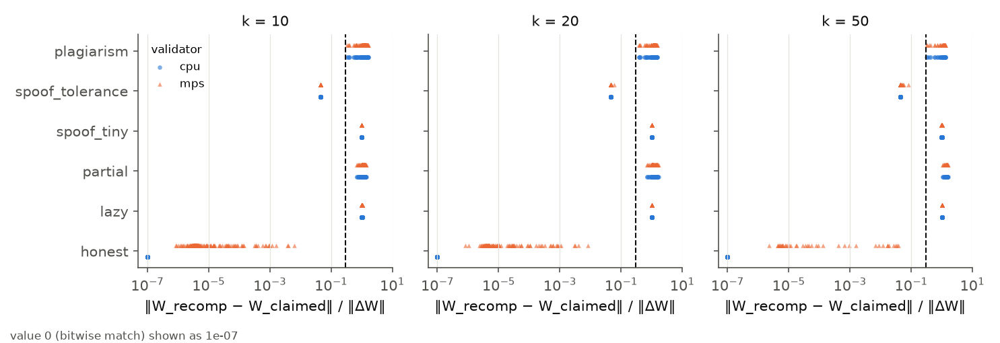
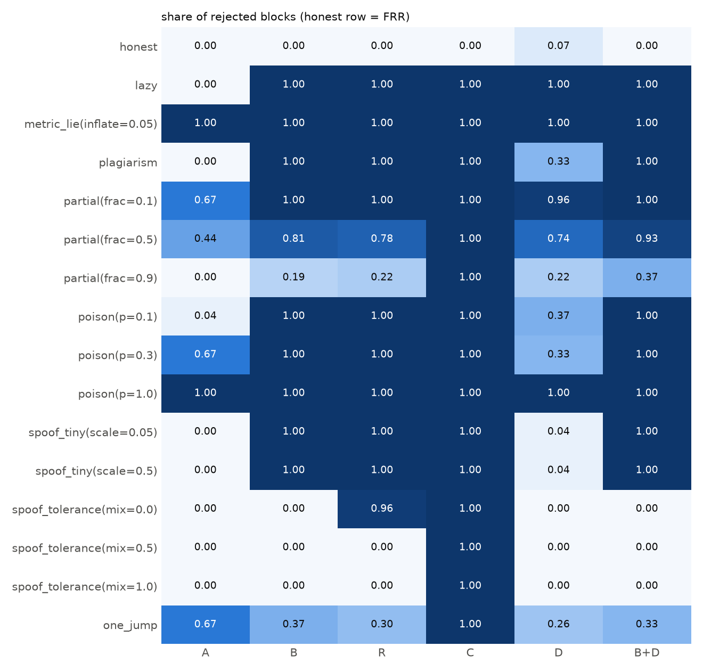
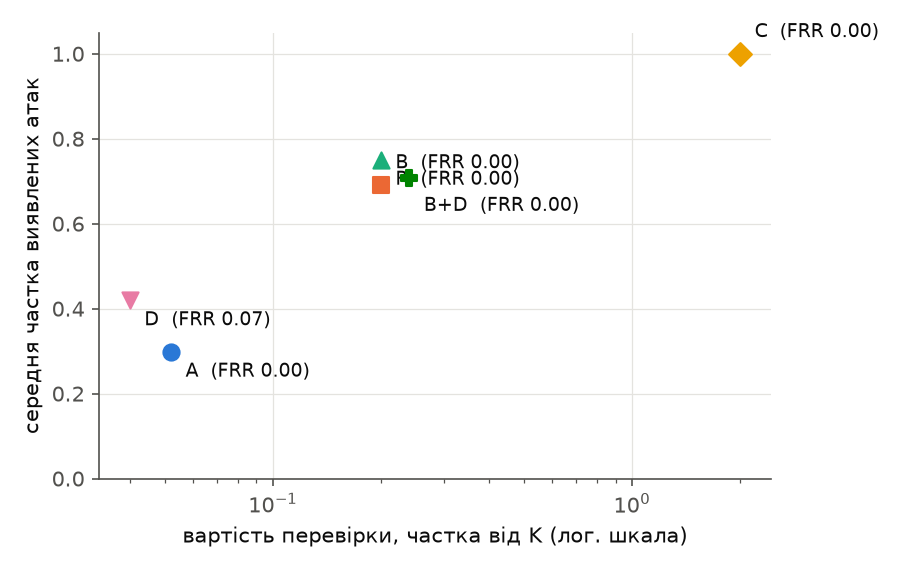
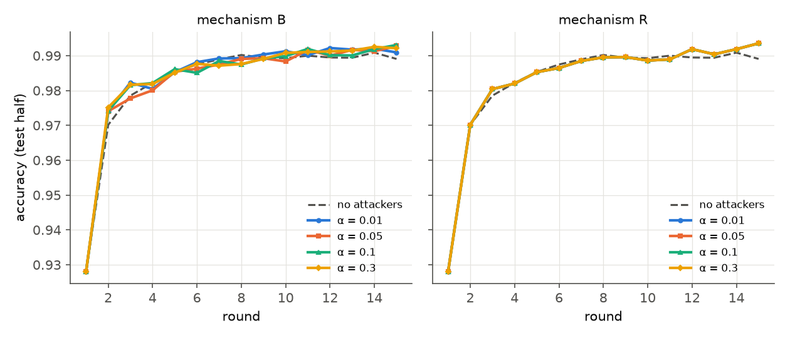
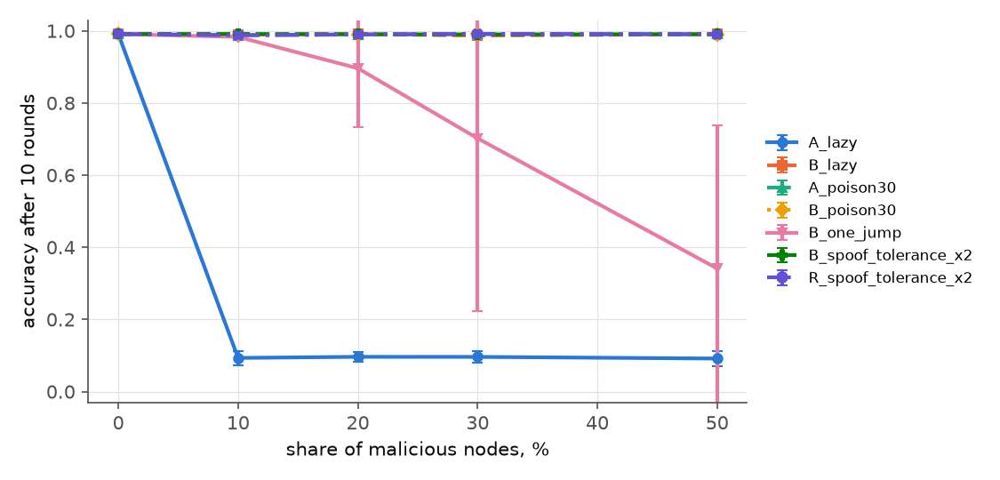

# Результати експериментів (оновлено 28.10.2026)

Стенд: CNN для MNIST (85 910 параметрів), блок K = 200 кроків SGD (lr = 0,05, B = 64), контрольна точка кожні
k = 20 кроків (m = 10 переходів). Mac M5: майнер на CPU, валідатори на CPU або MPS. Порогове правило B
відносне: ‖W_перерах − W_заявл‖ ≤ α·‖W_перерах − W_from‖. Метрику для механізму A майнер заявляє і валідатор
перевіряє на першій половині тестового набору MNIST, звітна точність — на другій.

Відтворення: команди в README, параметри й git-коміт кожного прогону — у `experiments/runs/<id>/manifest.json`.
Графіки — у `docs/figures/`. Код експериментів на момент прогонів: коміт `0a1f819` (у робочій теці були
незакомічені зміни лише в `sim/plots.py`, який експерименти не використовують).

---

## E1. Калібрування порогу B: чесний вузол на іншому залізі

Для кожного переходу чесного блоку валідатор перераховує k кроків і міряє відносну відстань.

| k | макс. відстань чесного вузла, CPU → MPS | FRR при α = 0 (B-exact) | α = 0,01 | α = 0,02 | α = 0,05 | переходів |
|---|---|---|---|---|---|---|
| 10 | 0,0063 | 1,00 | 0 | 0 | 0 | 200 |
| 20 | 0,0084 | 1,00 | 0 | 0 | 0 | 100 |
| 50 | 0,0387 | 1,00 | 0,20 | 0,10 | 0 | 40 |

- На тому самому пристрої (CPU → CPU) перерахунок побітово точний: відстань 0 у всіх 100 переходах.
- **B-exact (поріг 0) відхиляє 100 % чесних блоків з іншого заліза.** Точний збіг можливий лише з побітово
  відтворюваними обчисленнями (RepOps, OPEN-1B); звідси потреба в порозі.
- Обраний поріг **α = 0,05** для k ≤ 20: FRR = 0 на CPU ↔ MPS, запас ≥ 6× над найгіршим чесним переходом.
  Для k = 50 запас лише ~1,3×: довгі переходи накопичують розбіжність, тож k варто тримати ≤ 20.
- Атаки без роботи (lazy, partial, 5a, plagiarism) мають відносну відстань ~1, тобто на два порядки вище порогу.

## E2. Матриця «атака × механізм»

3 task_seed × 3 стани моделі (після 0, 3 і 8 раундів) × 3 повтори = 27 блоків на клітинку, один валідатор.
У дужках — 95 % довірчий інтервал Вільсона (для 27 спроб: 0/27 → [0; 0,12], 27/27 → [0,88; 1]).
«Шкода» — падіння звітної точності блоку атакувальника порівняно з чесним блоком того ж раунду.

| Атака | A | B | R | C | D | B+D | Шкода |
|---|---|---|---|---|---|---|---|
| **сумлінний (FRR)** | 0 | 0 | 0 | 0 | 0,07 [0,02; 0,23] | 0 | — |
| лінивий | 0 | 1 | 1 | 1 | 1 | 1 | 0,29 |
| завищена метрика (+0,05) | 1 | 1 | 1 | 1 | 1 | 1 | 0,29 |
| плагіат | 0 | 1 | 1 | 1 | 0,33 | 1 | 0 |
| часткова робота, 10 % | 0,67 | 1 | 1 | 1 | 0,96 | 1 | 0,62 |
| часткова робота, 50 % | 0,44 | 0,81 | 0,78 | 1 | 0,74 | 0,93 | 0,04 |
| часткова робота, 90 % | 0 | 0,19 | 0,22 | 1 | 0,22 | 0,37 | 0,001 |
| отруєння, p = 0,1 | 0,04 | 1 | 1 | 1 | 0,37 | 1 | 0,011 |
| отруєння, p = 0,3 | 0,67 | 1 | 1 | 1 | 0,33 | 1 | 0,10 |
| отруєння, p = 1 | 1 | 1 | 1 | 1 | 1 | 1 | 0,97 |
| 5a, крихітні кроки | 0 | 1 | 1 | 1 | 0,04 | 1 | 0,25–0,28 |
| 5c, зсув до отруєної моделі | 0 | 0 | **0,96** | 1 | 0 | 0 | 0,000 |
| 5c, напрямок 50 % випадковий | 0 | 0 | 0 | 1 | 0 | 0 | 0,000 |
| 5c, випадковий напрямок | 0 | 0 | 0 | 1 | 0 | 0 | 0,000 |
| **один стрибок** | 0,67 | 0,37 | 0,30 | 1 | 0,26 | 0,33 | **0,48** |
| **вартість перевірки, частка K** | 0,05 | 0,20 | 0,20 | 2,00 | 0,04 | 0,24 | |

Повтор із валідатором на MPS (9 блоків на клітинку, механізми A, B, R, D) дав ту саму картину: FRR B і R = 0,
FRR D = 0,11.

**Висновки E2**

1. **B — найкращий компроміс:** FRR = 0, ловить усі атаки без роботи за 20 % вартості блоку. Сліпий до двох
   класів: «майже чесна» часткова робота (90 %, шкоди майже немає) і **один стрибок**.
2. **Один стрибок — головна загроза для B.** 9 чесних переходів і 1 отруєний: шкода 0,48 точності, а B ловить
   лише якщо випадково перевірить саме зіпсований перехід. Окремий прогін (20 блоків × 2000 моделювань вибору)
   підтвердив формулу пропуску (1 − q/m)^V:

   | q | V = 1 (теорія / вимір) | V = 3 | V = 5 |
   |---|---|---|---|
   | 1 | 0,10 / 0,11 | 0,27 / 0,27 | 0,41 / 0,43 |
   | 2 | 0,20 / 0,22 | 0,49 / 0,47 | 0,67 / 0,68 |
   | 3 | 0,30 / 0,32 | 0,66 / 0,66 | 0,83 / 0,83 |
   | 5 | 0,50 / 0,50 | 0,88 / 0,89 | 0,97 / 0,98 |

   Значення 0,37 у матриці — статистичний шум на 27 спробах (інтервал [0,22; 0,56]).
3. **Атака на толерантність (5c) з каліброваним α = 0,05 майже нешкідлива:** зсув кожної точки на 4,5 % чесного
   оновлення не змінює точність помітно (шкода < 0,001). Тест напрямку залишків R ловить її у 96 % випадків,
   коли зсув спрямований до цілі; якщо атакувальник робить напрямок випадковим, R не бачить її, але й шкоди
   тоді немає. Отже, R змушує атакувальника обирати між непомітністю і користю для себе.
4. **C (реплікація) ловить усе**, але коштує 2 блоки на кожен блок. Плагіат без commit-reveal проходив би C
   (перевірено тестом); з commit-reveal він зводиться до лінивого.
5. **A сам по собі слабкий:** ловить лише брехню про метрику і груби отруєння; ліниве повторення проходить.
6. **D дешевий, але неточний:** 7–11 % хибних відхилень і пропускає плагіат та 5a.

## E4. Параметри перевірки

Одна вісь за раз, решта за замовчуванням; 2 task_seed × 2 стани × 3 повтори = 12 блоків на клітинку, один
валідатор (інтервали широкі, ±0,25 — дивитися на тенденції). Частка відхилених блоків:

| Налаштування | сумлінний (FRR) | лінивий | часткова 50 % | часткова 90 % | один стрибок | 5c | Вартість, частка K |
|---|---|---|---|---|---|---|---|
| B, q = 1 / 2 / 3 / 5 | 0 | 1 | 0,50 / 0,75 / 1 / 1 | 0,08 / 0,08 / 0,42 / 0,33 | 0 / 0,08 / 0,25 / 0,58 | 0 | 0,1 / 0,2 / 0,3 / 0,5 |
| B, k = 10 / 20 / 50 (валідатор на MPS) | 0 | 1 | 0,75 / 1 / 0,83 | 0,17 / 0,25 / 0 | 0,17 / 0,50 / 0,42 | 0 / 0,08 / 0,08 | 0,1 / 0,2 / 0,5 |
| A, підвибірка 200 / 1000 / 5000 | 0,17 / 0 / 0 | ≈ 0 | 0,42 / 0,33 / 0,25 | — | 0,92 / 0,50 / 0,50 | ≈ 0 | 0,005 / 0,03 / 0,13 |
| C, n = 3 / 5 | 0 | 1 | 1 | 1 | 1 | 1 | 2 / 4 |
| D, τ = 0 / 0,1 / 0,2 | 0 / 0 / 0,17 | 0,83 / 1 / 1 | 0,75 / 0,83 / 0,83 | — | 0,08 / 0,50 / 0,42 | 0 | 0,04 |

Висновки:
- **q — головний важіль проти «одного стрибка»:** виявлення одним валідатором росте приблизно як q/m
  (0 → 0,58 при q = 1 → 5, теорія 0,1 → 0,5), вартість — лінійно (q·k).
- **k:** при α = 0,05 хибних відхилень немає навіть для k = 50 на іншому пристрої, але дрібніші переходи (k = 10)
  дешевші на перевірку; запас порогу для k = 50 малий (E1), тому рекомендовано k ≤ 20.
- **A:** мала підвибірка (200) дає 17 % хибних відхилень через шум оцінки точності; 1000–5000 — нуль. Завищення
  метрики на 2 пункти ловиться тим частіше, чим більша підвибірка (0,42 → 0,75).
- **C:** ловить усе вже за n = 3; n = 5 лише подвоює вартість.
- **D:** τ = 0,1 — найкращий компроміс; τ = 0,2 уже дає хибні відхилення.

## E5. Шкода атаки на толерантність залежно від порогу α

6 вузлів, з них 2 атакувальники 5c з удвічі швидшим залізом, 15 раундів, 3 валідатори на блок,
3 повтори (seed 0–2, різні task_seed); точність — середнє ± стандартне відхилення.

| Механізм | α | Точність після 15 раундів | Раунди, виграні атакувальниками | Блоки 5c, відхилені |
|---|---|---|---|---|
| без атакувальників | — | 0,989 ± 0,001 | 0 | — |
| B | 0,01 / 0,05 / 0,1 / 0,3 | 0,991 / 0,993 / 0,993 / 0,992 (± ≤ 0,003) | 27 % у всіх | 0 % |
| R | 0,01 / 0,05 / 0,1 / 0,3 | 0,994 ± 0,001 у всіх | 0 % | 100 % |

**Висновок:** у цьому стенді навіть широкий поріг α = 0,3 не дає атакувальникові 5c помітно зіпсувати модель:
сумлінні блоки між його блоками виправляють зсув. Проте він отримує ~27 % нагород, не виконуючи корисної
роботи понад чесну (його блок дорожчий), — тобто 5c тут атака на розподіл нагород, а не на якість.
R відсікає її повністю за тієї ж вартості, що й B.

## E3. Частка зловмисних вузлів

10 вузлів, 10 раундів, 3 валідатори на блок, 3 повтори (seed 0–2); точність — середнє ± стандартне відхилення.

| Сценарій | 0 % | 10 % | 20 % | 30 % | 50 % |
|---|---|---|---|---|---|
| A, лінивий: точність | 0,991 ± 0,003 | 0,093 ± 0,020 | 0,096 ± 0,013 | 0,096 ± 0,017 | 0,092 ± 0,021 |
| A, лінивий: виграні раунди | 0 | 100 % | 100 % | 100 % | 100 % |
| B, лінивий: точність | 0,991 | 0,990 | 0,991 | 0,987 | 0,991 |
| A / B, отруєння 30 %: точність | 0,991 | 0,988 | 0,990 | 0,991 | 0,990 |
| B, один стрибок: точність | 0,991 | 0,983 ± 0,007 | 0,896 ± 0,164 | 0,702 ± 0,479 | 0,341 ± 0,396 |
| B, один стрибок: виграні раунди | 0 | 7 % | 3 % | 13 % | 40 % |
| B, 5c (×2 швидкість): виграні раунди | 0 | 7 % | 17 % | 43 % | 43 % |
| R, 5c (×2 швидкість): виграні раунди | 0 | 0 | 0 | 0 | 0 |

**Висновки:** з одним лише механізмом A мережа зупиняється навіть при 10 % лінивих вузлів: вони подають блок
першими, і A їх пропускає. З B ліниві вузли й отруювачі не виграють жодного раунду. Один стрибок проходить B:
за 50 % атакувальників середня точність падає до 0,34, а в окремих повторах модель руйнується повністю
(великий розкид — один виграний стрибок псує модель, і її відновлення залежить від того, хто виграє далі).

## E6. Узагальнення: Fashion-MNIST

Та сама матриця на Fashion-MNIST (1 task_seed × 3 стани × 3 повтори = 9 блоків на клітинку, репліки C на CPU і MPS).

| Атака | A | B | R | C | D | Шкода |
|---|---|---|---|---|---|---|
| **сумлінний (FRR)** | 0,11 | 0 | 0 | 0 | 0,11 | — |
| лінивий | 0 | 1 | 1 | 1 | 1 | 0,19 |
| плагіат | 0,11 | 1 | 1 | 1 | 0,22 | 0 |
| часткова робота 90 % | 0 | 0,22 | 0,11 | 1 | 0 | 0 |
| отруєння, 30 % міток | 0,44 | 1 | 1 | 1 | 0,44 | 0,06 |
| 5c, зсув до цілі | 0 | 0 | 0,89 | 1 | 0 | 0 |
| один стрибок | 0,67 | 0,22 | 0,33 | 1 | 0 | 0,32 |

Висновки E2 зберігаються: B і R не відхиляють чесних блоків і ловлять усі атаки без роботи; один стрибок
проходить B у ~78 % випадків; R ловить 5c; A і D дають хибні відхилення (11 %).

## Арена: адаптивні стратегії

`python -m sim.arena --validators 3` — 7 стратегій, 2 task_seed × 2 стани × 3 повтори = 12 блоків на клітинку,
3 незалежні валідатори на блок. Частка блоків, що **пройшли** перевірку:

| Стратегія | A | B | R | C | D | Робота, частка K | Шкода |
|---|---|---|---|---|---|---|---|
| сумлінна | 1 | 1 | 1 | 1 | 1 | 1,00 | 0 |
| лінива | 1 | 0 | 0 | 0 | 0 | 0 | 0,42 |
| екстраполяція (2 переходи чесно) | 0,50 | 0 | 0 | 0 | 0 | 0,20 | 0,50 |
| один стрибок | 0,50 | 0,67 | 0,42 | 0 | 0,50 | 1,00 | 0,32 |
| м'який стрибок (p = 0,3, lr × 3) | 0,83 | 0,75 | 0,25 | 0 | 0,58 | 1,00 | 0,005 |
| 5c, зсув до цілі | 1 | 1 | 0 | 0 | 1 | 2,00 | 0,001 |
| 5c з камуфляжем проти R | 1 | 1 | 1 | 0 | 1 | 2,00 | 0,001 |

Висновки: жодна стратегія, що економить роботу, не проходить B; шкідливі стратегії, що проходять B, — це
«стрибки» (рятує лише більше q·V або C), а атаки на поріг проходять B, але майже не шкодять. Камуфльована 5c
обходить і R — це межа запропонованого тесту. C ловить усе ціною подвоєння обчислень.

## Економіка обману

`python -m sim.economics experiments/runs/e2` (N = 4 майнери, нагорода 8 одиниць K, 3 валідатори).
Мінімальна застава S*, за якої обман невигідний (одиниця — вартість одного блоку):

| Атака | B, s = 0 | B, s = 0,5 | R, s = 0 | R, s = 0,5 |
|---|---|---|---|---|
| часткова робота 90 % | 5,3 | 15,1 | 3,5 | 11,4 |
| часткова робота 50 % | не потрібна | не потрібна | не потрібна | не потрібна |
| лінивий, 5a | не потрібна | не потрібна | не потрібна | не потрібна |

s — частка валідаторів, які «лінуються» і пропускають перевірку (дилема верифікатора). Якщо половина
валідаторів не перевіряє, потрібна застава зростає втричі. Для атак на якість (отруєння, один стрибок)
грошового мотиву немає, і застава їх не стримує: потрібне саме виявлення.

---

## Загальні висновки

1. Перевірка B з каліброваним порогом — найкраще співвідношення «виявлення / вартість»: FRR = 0 між CPU і MPS,
   усі атаки без роботи ловляться за 20 % вартості блоку.
2. Найслабше місце B — атаки, що підробляють мало переходів (один стрибок). Їх стримує лише кількість
   перевірок q·V або реплікація C; формула (1 − q/m)^V підтверджена експериментально і дає правило вибору q.
3. Поріг толерантності — реальне вікно для атаки, але на цьому стенді воно дає атакувальникові нагороди, а не
   шкоду моделі. Запропонований тест напрямку залишків R закриває це вікно без додаткової вартості.
4. Механізм A потрібен лише як доповнення (брехня про метрику); D без кращого калібрування не варто вмикати.

## Обмеження

- Одна мала CNN; MNIST і Fashion-MNIST; «інше залізо» — лише CPU ↔ MPS на одному Mac (T4 — `docs/kaggle.md`).
- E3, E5 — 3 повтори, E6 — 9 блоків на клітинку: інтервали для частот ще широкі.
- 5c атакує лише в напрямку моделі з перекрученими мітками; цільові атаки (бекдор) можуть бути шкідливішими.
- Адаптивного атакувальника, який одночасно обходить B і R, не досліджено повністю (лише змішування напрямку).
- Економічна модель спрощена: однакова швидкість чесних майнерів, фіксована нагорода.
